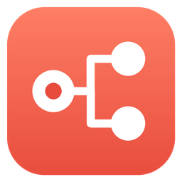
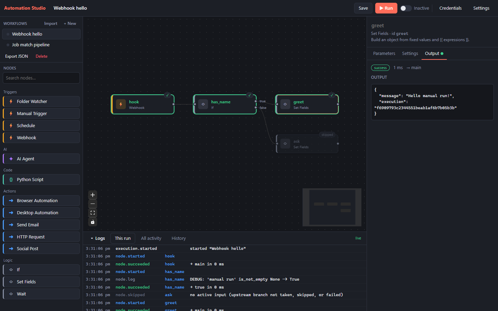
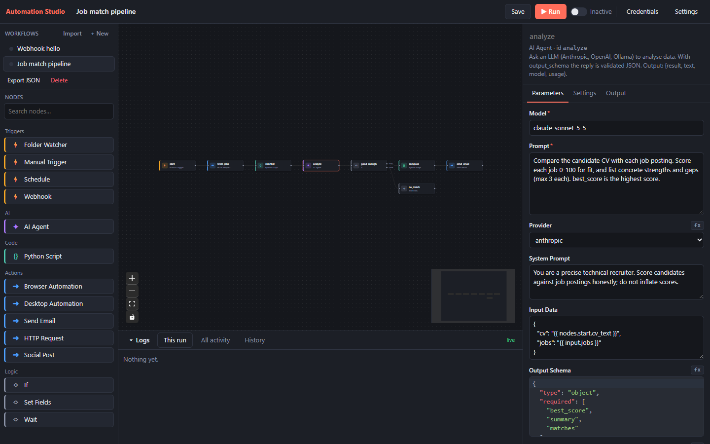

<div align="center">



# Automation Studio

**Build automations on a visual canvas and run them on your own Windows PC.**
Webhooks, folder watchers, schedules, AI agents, Python scripts, and browser and desktop automation.
Everything stays on your machine.

[](https://github.com/Agni-glitch/automation-studio/actions/workflows/ci.yml)
[](https://github.com/Agni-glitch/automation-studio/releases/latest)
[](LICENSE)


**[Download for Windows](https://github.com/Agni-glitch/automation-studio/releases/latest)** ·
[Getting started](docs/getting-started.md) ·
[Node reference](docs/nodes.md) ·
[Contributing](CONTRIBUTING.md)



</div>

## Why Automation Studio

- **Local first.** Workflows, run history and credentials live on your PC, with no account and
  no cloud service. Credentials are encrypted and tied to your Windows user account.
- **Visual, not limiting.** Drag nodes, connect them and watch each step run live. When you need
  code, drop in a sandboxed Python step or call any model through the AI Agent node.
- **Runs in the background.** Close the window and active workflows keep listening for
  webhooks, files and schedules. A tray icon tells you when something fails.
- **Reachable when you need it.** One switch gives your webhooks a public HTTPS URL through
  Cloudflare Tunnel, and only the workflows you mark public answer it.

## Features

| | |
|---|---|
| **Triggers** | Manual, webhook (with optional reply), folder watcher, and cron or interval schedules |
| **AI** | AI Agent node for Anthropic, OpenAI (or any compatible server) and local Ollama models, with JSON-schema validated output |
| **Code** | Python Script node in a separate, resource-limited process; Python is bundled with the app |
| **Actions** | HTTP requests, email over SMTP, LinkedIn posts, browser automation with Microsoft Edge (Playwright), desktop automation (mouse, keyboard, screenshots, image matching) |
| **Logic** | If branches, Set fields, Wait; `{{ expressions }}` to pass data between steps |
| **Reliability** | Per-node retries with backoff, timeouts, error outputs, parallel branches, run history |
| **Operations** | Start at sign-in, tray icon with failure notifications, verified in-app updates, and a `studio` command line for scripting |



## Install

1. Download **`AutomationStudio-Setup-<version>.exe`** from the
   [latest release](https://github.com/Agni-glitch/automation-studio/releases/latest).
2. Run it. It installs for your account only, needs no administrator rights, and adds Start
   menu and desktop shortcuts.
3. The app isn't code-signed yet, so Windows may show *"Windows protected your PC"*. Choose
   **More info → Run anyway**. Each release lists SHA-256 checksums if you want to check the
   file first.

Prefer not to install? Download the **portable zip**, unzip it anywhere and run
`AutomationStudio.exe`. Requires Windows 10 (1809 or later) or Windows 11, 64-bit.

## Your first workflow

1. Download [`examples/webhook_hello.json`](examples/webhook_hello.json) from this repo. In
   Automation Studio, choose **Import**, pick the file, then **Save**.
2. Press **Run**. The nodes light up as they run, and selecting **greet** shows its output.
3. Switch the workflow to **Active**, then call it from PowerShell:

   ```powershell
   Invoke-RestMethod -Method Post http://127.0.0.1:5678/webhook/hello `
     -ContentType application/json -Body '{"name": "Ada"}'
   ```

The [getting started guide](docs/getting-started.md) covers credentials, AI models, schedules,
folder watching and public webhooks.

## Documentation

| Guide | What's in it |
|---|---|
| [Getting started](docs/getting-started.md) | Installing, the editor, credentials, triggers, running in the background, public webhooks, updates |
| [Nodes and workflows](docs/nodes.md) | Every node and trigger, expressions, branching, retries and errors, the workflow JSON format |
| [Command line](docs/cli.md) | `studio` commands for running, importing and scheduling workflows from scripts |
| [Architecture](docs/architecture.md) | How the engine, service, editor and desktop app fit together, and the security model |
| [Building and releasing](docs/building.md) | Building the installer, publishing releases, code signing |

## Run from source

```powershell
git clone https://github.com/Agni-glitch/automation-studio.git
cd automation-studio
python -m venv .venv; .venv\Scripts\activate
pip install -e ".[dev,browser,desktop,build]"
cd frontend; npm ci; npm run build; cd ..
python main.py open
```

Needs Python 3.11+ and Node.js 20+. See [CONTRIBUTING.md](CONTRIBUTING.md) for the
development workflow and how to add a node.

## Contributing

Contributions are welcome, especially new nodes, example workflows and docs. Read the
[contributing guide](CONTRIBUTING.md), and open an issue before starting anything large.
Please follow the [Code of Conduct](CODE_OF_CONDUCT.md), and report security problems
privately as described in [SECURITY.md](SECURITY.md).

## License

[MIT](LICENSE)
